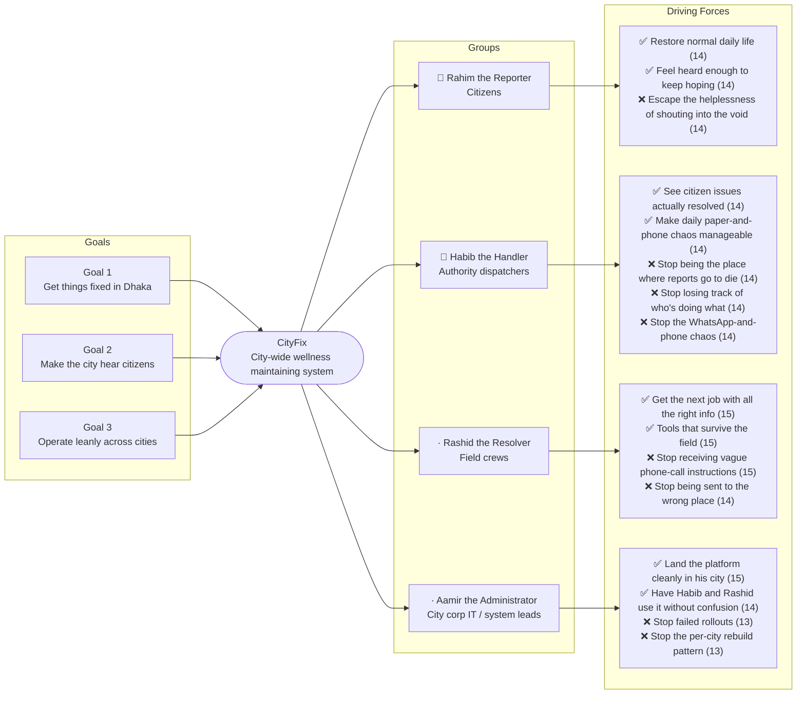

# Trigger Map — CityFix

> Phase 2 — Trigger Mapping
> Source: Workshops 1–4, product-brief.md (2026-09-18)
> Status: Draft — pending review

---

## The Map

---

## Business Goals

| Goal | Vision | Key Objectives |
|------|--------|----------------|
| **G1** | Get things fixed in Dhaka | 1.1 Closure-rate at level citizens experience as "it worked" · 1.2 Median time-to-resolution faster than baseline · 1.3 Repeat-report share proves follow-through |
| **G2** | Make the city hear citizens | 2.1 Every report has a status trail · 2.2 Overdue tickets publicly visible · 2.3 Citizen satisfaction with the experience reaches target |
| **G3** | Operate leanly across cities | 3.1 New-city onboarding is configuration only · 3.2 Cost-per-citizen within ceiling · 3.3 Second city live within 18 months of Dhaka launch |

→ Full detail: [01-business-goals.md](01-business-goals.md)

---

## Target Groups

| Priority | Persona | Goals served | Persona page |
|----------|---------|--------------|--------------|
| 👥 **Primary** | Rahim the Reporter (Citizens) | G1, G2 | [02-persona-rahim-the-reporter.md](02-persona-rahim-the-reporter.md) |
| 👤 **Secondary** | Habib the Handler (Authority dispatchers) | G1, G2, G3 | [03-persona-habib-the-handler.md](03-persona-habib-the-handler.md) |
| · **Tertiary** | Rashid the Resolver (Field crews) | G1 (primary), G2 (indirect), G3 (clone-ability) | [04-persona-rashid-the-resolver.md](04-persona-rashid-the-resolver.md) |
| · **Secondary (administrative)** | Aamir the Administrator (City corp IT / system leads) | G3 (primary), G1 (enabler), G2 (enabler) | [05-persona-aamir-the-administrator.md](05-persona-aamir-the-administrator.md) |

---

## Driving Forces — Priority Summary

Sorted by FIA score (Frequency + Intensity + Fit /15). Scores ≥ 13 are high-priority design inputs.

| Score | Force | Group | Direction |
|-------|-------|-------|-----------|
| **15** | Get the next job with all the right information | Rashid | ✅ Positive |
| **15** | Have tools that survive the field | Rashid | ✅ Positive |
| **15** | Stop receiving vague phone-call instructions | Rashid | ❌ Negative |
| **15** | Land the platform cleanly in his city | Aamir | ✅ Positive |
| **14** | Restore normal, low-friction daily life | Rahim | ✅ Positive |
| **14** | Feel heard enough to keep hoping | Rahim | ✅ Positive |
| **14** | Escape the helplessness of shouting into the void | Rahim | ❌ Negative |
| **14** | See citizen issues actually resolved | Habib | ✅ Positive |
| **14** | Make daily paper-and-phone chaos manageable | Habib | ✅ Positive |
| **14** | Stop being the place where reports go to die | Habib | ❌ Negative |
| **14** | Stop losing track of who's doing what | Habib | ❌ Negative |
| **14** | Stop the WhatsApp-and-phone chaos | Habib | ❌ Negative |
| **14** | Stop being sent to the wrong place | Rashid | ❌ Negative |
| **14** | Have Habib and Rashid use it without confusion | Aamir | ✅ Positive |
| **13** | Stop the frustration loop | Rahim | ✅ Positive |
| **13** | Protect family from city-level hazards | Rahim | ✅ Positive |
| **13** | Reclaim his own time and dignity | Rahim | ✅ Positive |
| **13** | Escape the daily grind of small broken things | Rahim | ❌ Negative |
| **13** | Avoid the time-sink of official reporting | Rahim | ❌ Negative |
| **13** | Look competent to supervisor and team | Habib | ✅ Positive |
| **13** | Feel the ward is actually moving | Habib | ✅ Positive |
| **13** | Be trusted by citizens on call-back | Habib | ✅ Positive |
| **13** | Stop drowning in duplicate paper tickets | Habib | ❌ Negative |
| **13** | Stop having no answer when citizens call back | Habib | ❌ Negative |
| **13** | Stop feeling stuck in a system that doesn't move | Habib | ❌ Negative |
| **13** | Stop doing the same fix twice | Rashid | ❌ Negative |
| **13** | Stop the paperwork no one reads | Rashid | ❌ Negative |
| **13** | Stop the day-long search for a single problem | Rashid | ❌ Negative |
| **13** | See adoption metrics climbing | Aamir | ✅ Positive |
| **13** | Configuration discoverable and reversible | Aamir | ✅ Positive |
| **13** | Stop failed rollouts | Aamir | ❌ Negative |
| **13** | Stop hidden complexity in admin UX | Aamir | ❌ Negative |
| **13** | Stop misalignment between config and downstream UX | Aamir | ❌ Negative |
| **13** | Stop the first month of chaos | Aamir | ❌ Negative |
| **13** | Stop the per-city rebuild pattern | Aamir | ❌ Negative |
| **12** | Avoid the moment his family gets hurt | Rahim | ❌ Negative |
| **12** | Avoid deepening cynicism | Rahim | ❌ Negative |
| **12** | Build a record that survives paper register | Habib | ✅ Positive |
| **12** | Stop looking passive to supervisor | Habib | ❌ Negative |
| **12** | Feel his work is recognized | Rashid | ✅ Positive |
| **12** | Move fast between jobs | Rashid | ✅ Positive |
| **12** | Be seen as the person who made it work | Aamir | ✅ Positive |
| **12** | Defend setup decisions with an audit trail | Aamir | ✅ Positive |
| **12** | Stop being on the hook for every glitch | Aamir | ❌ Negative |
| **12** | Stop magic that breaks at scale | Aamir | ❌ Negative |
| **11** | Stop being the invisible end of the chain | Rashid | ❌ Negative |
| **11** | Move on to other work after launch | Aamir | ✅ Positive |
| **9** | Help shape how the city responds | Habib | ✅ Positive |

**Key read:**
Rashid's operational forces score highest (3× at 15), and Aamir's top force now also reaches 15 — landing the platform cleanly in his city is critical because every other persona depends on his configuration working. Habib's negative forces cluster at 14 (being the dead end, losing track, channel chaos), telling us that **the cost of friction inside city corp is as much a barrier as any citizen-side feature**. Rahim's positive forces split evenly between *fixing the world* (14) and *being heard* (14) — both must be in v1, and neither can substitute for the other. Aamir's negative forces cluster at 13 (six distinct forces all scoring 13) — **admin UX is a higher-friction surface than it looks**, and a single bad configuration choice cascades into every downstream user. Overall pattern: **process-integrity forces dominate** (visibility, tracking, clarity, accountability) over emotional or aspirational forces — CityFix is a platform whose success is gated by *operational clarity*, not by emotional design.

---

_Produced by Saga — 2026-09-18_
_Source: 01-business-goals.md, 02–05-persona-*.md_
_Updated: admin persona (05) added in response to v1 scope confirmation_
